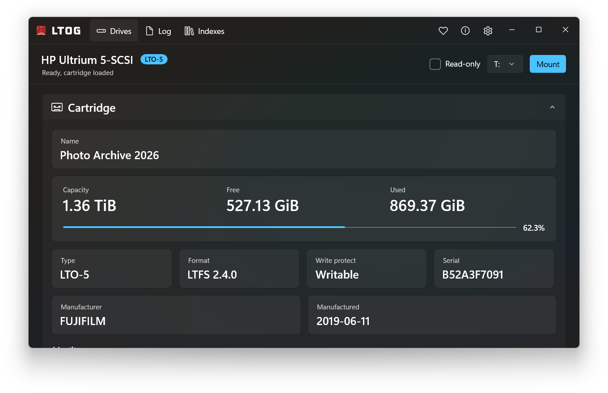

<h1 align="center"> LTOG</h1>

[简体中文](README.md) | English

<p align="center">
  <a href="https://github.com/rlaphoenix/LTOG/blob/main/LICENSE">
    
  </a>
  
  <a href="https://github.com/microsoft/microsoft-ui-xaml">
    
  </a>
  <a href="https://github.com/rlaphoenix/WinLtfs">
    
  </a>
</p>



LTOG is a modern LTO tape manager for Windows that lets you use tape like any other drive. Format a
cartridge with [LTFS 2.4](https://www.lto.org/ltfs/), mount it as a drive letter, and drag, drop, and
browse files in File Explorer without proprietary backup software. Tapes follow the open LTFS standard,
so they stay readable on any LTFS-compatible system. Tape mounting is powered by
[WinLtfs](https://github.com/rlaphoenix/WinLtfs).

This repository is the Simplified Chinese edition of [rlaphoenix/LTOG](https://github.com/rlaphoenix/LTOG).
It provides a Chinese interface and queued completion dialogs for tape mounting and clean unmounting.

Download the [verified Windows x64 installer](https://github.com/csfh-cyber/WinLTFS-LTOG_cn/releases/download/cn-v2.0.0-20261029/LTOG-2.0.0-setup.exe).
SHA256 checksums are available on the [download page](https://github.com/csfh-cyber/WinLTFS-LTOG_cn/releases/tag/cn-v2.0.0-20261029).

## ⚠️ Data Loss Warning

Every measure has been taken to prevent data loss but it can still occur in rare cases.

Why? Tape drives have an internal memory buffer that stores written data before flushing it to the
tape. When Moving files from, say an SSD, to the virtual LTO drive, it gets written to this internal
memory buffer that we cannot control. Once moved to the memory buffer, Windows marks the original file
moved and ready for deletion. If the tape drive, cartridge, cabling, or host adapter has an unexpected
or intermittent failure before actually flushing to the cartridge, Windows may delete the file anyway.

Copying instead of moving files or folders prevents this issue as you will retain the original file on
your computer. You should only delete the copied over files or folders once you actually unmount the
tape drive, not when the file transfer finishes.

## Features

- 🖥️ Native WinUI 3 GUI
- 📼 LTO-5–LTO-9 on the supported drives listed below
- 🗂️ LTFS 2.4.0 Support
- 💽 Virtual Drive Mounting
- 💾 Automatic Index Backup
- 🔒 Honors Write-Protection and Read-Only
- 🛡️ WHQL-signed Drivers
- ❤️ Forever FLOSS (GPLv3)

## Requirements

- Windows 10/11, or Windows Server 2019 or newer (64-bit only)
- An LTO-5 or newer cartridge with a compatible LTO Tape Drive

### Supported tape drives

Tape-drive compatibility is provided by the [WinLtfs backend](https://github.com/rlaphoenix/WinLtfs/blob/v1.2.0/README.md#supported-tape-drives):

| Brand | LTO-5 | LTO-6 | LTO-7 | LTO-8 | LTO-9 |
| --- | :---: | :---: | :---: | :---: | :---: |
| HP / HPE | ✅ | ✅ | ✅ | ✅ | ✅ |
| Quantum | ✅ | ✅ | ✅ | ✅ | ✅ |
| Tandberg | ✅ | ✅ | ❓ | ❓ | ❓ |
| IBM | ❌ | ❌ | ❌ | ❌ | ❌ |

- ✅ means supported by the upstream whitelist or reported hardware testing.
- ❓ means compatibility still needs hardware testing.
- ❌ means unsupported by the bundled tape backend; IBM drives require a different backend.

These are **drive** brands, not cartridge brands. Match the cartridge generation to the drive's own
specification; this table does not imply that every drive can read or write every LTO generation.

WinLtfs recognizes the SCSI INQUIRY product ID: HP/HPE `Ultrium N-SCSI`, Quantum `ULTRIUM N`,
and Tandberg `LTO-N HH`, where `N` is the generation. Check Device Manager → Properties → Details →
Hardware Ids, or use a SCSI inquiry tool. OEM branding alone does not establish compatibility.
Report additional models or test results to [WinLtfs](https://github.com/rlaphoenix/WinLtfs/issues).

## HPE StoreOpen background and source lineage

HPE's [official StoreOpen 3.6 Windows user guide](https://support.hpe.com/hpesc/public/docDisplay?docId=sd00001247en_us&page=GUID-D7147C7F-2016-0901-084D-000000000473.html&docLocale=en_US)
states that StoreOpen was **discontinued on 31 July 2026 and is no longer available for download**.
HPE retained the guide for existing users and removed its installation information.

StoreOpen 3.6 did exist: its [official documentation](https://support.hpe.com/hpesc/public/docDisplay?docId=sd00001245en_us&docLocale=en_US)
remain accessible. The missing material described by [WinLtfs upstream](https://github.com/rlaphoenix/WinLtfs/blob/b2bcbd2db15e26975133e412f49f609967177a36/README.md#background)
is the **3.6.0 source code**: its maintainer reports finding no surviving source download, mirror or archive.
HPE's [download-availability guidance](https://support.hpe.com/hpesc/public/docDisplay?docId=sf000117077en_us&docLocale=en_US)
also distinguishes missing portal versions from account or entitlement access; documentation availability
does not establish that source code can be downloaded.

WinLtfs therefore continues from preserved **HPE StoreOpen 3.5.0 source**, credited to
[leavelet/ltfs-hp](https://github.com/leavelet/ltfs-hp), rather than a recovered 3.6.0 tree.
It replaces the old UMFSDK/FUSE4Win filesystem integration with [WinFsp](https://winfsp.dev).
LTOG provides the GUI on top of that engine; this Chinese edition adds UI translations and completion dialogs.

### Upstream source branches

| Branch | Role |
| --- | --- |
| [`hpe`](https://github.com/rlaphoenix/WinLtfs/tree/hpe) | HPE StoreOpen 3.5.0 source baseline, including its original Windows integration and licensing. |
| [`master`](https://github.com/rlaphoenix/WinLtfs/tree/master) | Maintained WinFsp port, command-line tools, device compatibility and documentation. |
| [`feat-shellext`](https://github.com/rlaphoenix/WinLtfs/tree/feat-shellext) | Experimental Explorer shell extension, separate from the standard installer. |

## Building

First clone and enter the repository:

```shell
git clone https://github.com/csfh-cyber/WinLTFS-LTOG_cn.git
cd WinLTFS-LTOG_cn
```

Then build the LTFS+WinFsp engine, the GUI, and the Installer with `.\build`.
Instructions below show how to individually build each part of the project.

### 1. WinLtfs (LTFS + WinFsp)

The LTFS executables, tape backends, and `winfsp-x64.dll` are supplied by the
[WinLtfs](https://github.com/rlaphoenix/WinLtfs) project.

To build the engine from source yourself (MSYS2 + WinFsp toolchain), follow the
build instructions in the [WinLtfs](https://github.com/rlaphoenix/WinLtfs) repo,
then copy its `dist/` output into LTOG's `dist/winltfs/`.

### 2. GUI

Install the .NET 8 SDK:

```shell
winget install -e Microsoft.DotNet.SDK.8
```

In PowerShell:

```powershell
cd src  # enter the source folder
dotnet build LTOG.csproj -c Release -p:Platform=x64  # build (self-contained)
robocopy "bin\x64\Release\net8.0-windows10.0.19041.0\win-x64" "..\dist" /E  # self-contained output -> ..\dist
```

### 3. Installer

With `dist/` fully populated (LTFS engine + GUI), build the Windows installer:

```powershell
pwsh -ExecutionPolicy Bypass -File installer\build-installer.ps1
```

It fetches what it needs and writes `setup.exe` to `installer\Output\`.

## Licensing

LTOG as a whole is distributed under the **GNU General Public License v3.0**
(see [LICENSE](LICENSE)).

A full per-component inventory — every redistributed binary, its license,
copyright, and corresponding source — is in
[THIRD-PARTY-NOTICES.md](THIRD-PARTY-NOTICES.md), with the license texts in
[`licenses/`](licenses/). The installer ships these alongside the binaries.

---

© rlaphoenix 2026
